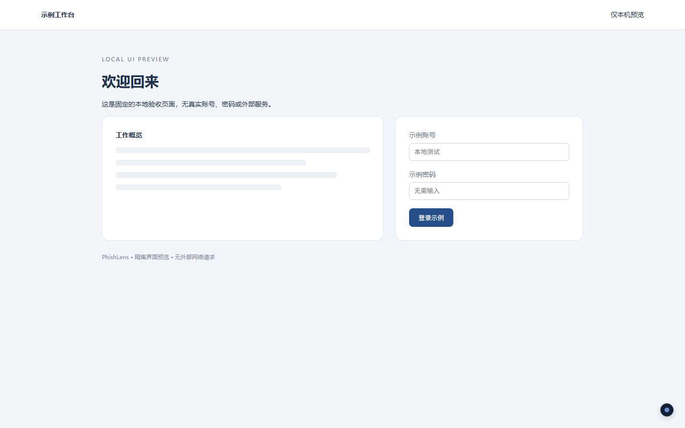
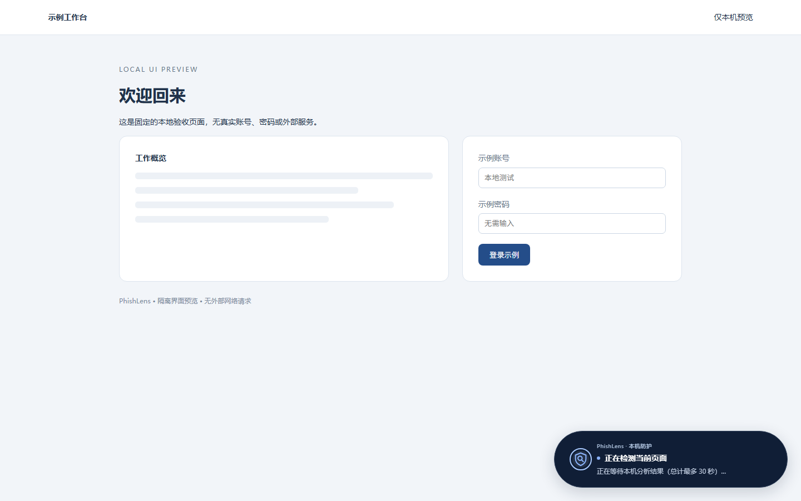
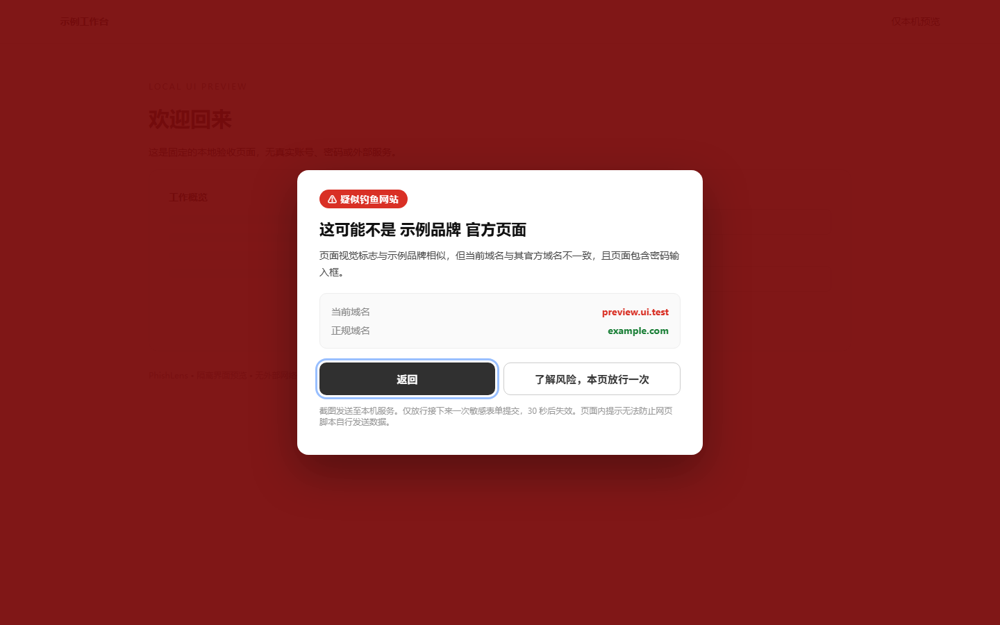

# PhishLens Edge

在本机分析网页截图、品牌标志、域名与登录表单的反钓鱼研究原型。浏览器扩展连接本地 Python 服务，给出“未发现明确风险 / 未确认 / 疑似仿冒”及检测依据。

**截图仅发送到本机服务，不上传云端。浏览器扩展版本：0.2.4。**

## 界面与功能

- 默认显示 **28px 小圆点**，颜色表示检测状态；点击展开胶囊提示，点击盾牌或按 Esc 收起。
- 疑似仿冒页面显示红底白卡警告，列出品牌、当前域名、正规域名和判定依据。
- 30 秒请求时限、有限自动重试、标签切换恢复、页面变化后重新校验。
- 可选桌面悬浮窗和托盘入口；截图本身不能核实网址身份。
- 默认 CPU 推理，使用 PhishIntention 检测器与 OCR 辅助 Siamese 特征库。

| 收起状态 | 展开状态 |
|---|---|
|  |  |



界面预览使用本地模拟页面和模拟结果，不是检测准确率证明。

## 目录

```text
browser-extension/   Edge Manifest V3 扩展
server/              FastAPI 本地检测服务
brand_library/       品牌元数据、Logo 素材及特征生成工具
testset/fake/        无外部请求、禁止提交的本地演示页面
tests/               Python 与 JavaScript 离线回归
tools/               启停、环境检查、模型准备、评估与便携包工具
docs/                复现记录、历史评估与界面预览
model/               已停用 UCI 分类器的历史指标与特征说明
phishlens_guard.py   桌面悬浮窗
tray_guard.py        托盘守护入口
```

`.venv/`、`third_party/`、数据集、模型权重、生成的 Siamese 索引、日志、备份和便携运行环境仅保留本地，不提交 Git。便携包不包含在源码仓库中。

## 已配置的 Windows 电脑

1. 双击根目录的 **启动项目.bat**，等待本地服务就绪。
2. 在 Edge 打开 `edge://extensions/`，开启开发人员模式，加载项目中的 `browser-extension` 文件夹。已有扩展则点击“重新加载”。
3. 打开 `http://127.0.0.1:8001/fake_alipay.html`。更新扩展后刷新已打开的网页。
4. 用完双击 **停止项目.bat**。可选悬浮窗从 **启动悬浮窗.bat** 启动，退出时关闭悬浮窗。

服务位于 `http://127.0.0.1:8765`，状态接口为 `/health`。模型首次加载可能较慢；服务可访问不等于模型已就绪。运行日志位于 `.maintenance/runtime/`。

## 从源码准备环境

推荐 Windows x64、Python **3.11** 和 Microsoft Edge。基础依赖足以运行离线回归；完整视觉推理还需要视觉依赖和模型。

```powershell
git clone https://github.com/wushifdvcbavgh11/PhishLens-Edge.git
cd PhishLens-Edge
py -3.11 -m venv .venv
.\.venv\Scripts\python.exe -m pip install -r requirements.txt
```

完整视觉环境请结合 [PhishIntention 复现说明](docs/T3-phishintention-repro.md) 和 [依赖说明](docs/T16-setup-and-deps.md) 配置：

```powershell
git clone https://github.com/lindsey98/PhishIntention.git third_party/PhishIntention
.\.venv\Scripts\python.exe tools/setup_vision.py
.\.venv\Scripts\python.exe tools/download_weights.py
.\.venv\Scripts\python.exe tools/build_brand_references.py
.\.venv\Scripts\python.exe tools/check_env.py
```

`setup_vision.py` 优先使用本地 wheel；detectron2 的 Windows CPU wheel 需按复现说明准备。`download_weights.py` 下载约 1.6 GB 模型。模型和参考素材准备好后，`build_brand_references.py` 才能生成与本机文件哈希一致的 `brand_library/siamese/`。缺失或不一致时，服务不会把未完成检测当作通过。

桌面入口的可选依赖：

```powershell
.\.venv\Scripts\python.exe -m pip install -r requirements-desktop.txt
```

完整视觉环境仍需在目标电脑单独验收。旧 `check_env.py` 的 UCI/MobileNet 检查涉及历史实验资产；当前浏览器决策不依赖 UCI 分类器。

## 测试与本地演示

安装 Node.js 后，从项目根目录执行：

```powershell
.\tools\run_reliability_checks.ps1
```

当前离线回归包括 **58 项 Python 检查、76 项 JavaScript 检查**，涵盖请求超时、重试、页面身份、一次放行、桌面结果、缓存、示例页面、小圆点展开与收起。测试使用模拟视觉结果，不代表真实模型准确率。

`testset/fake/` 的 HTML 已内嵌素材并禁止提交。不要输入真实账号、密码或验证码。重新生成三种基本品牌演示页：

```powershell
.\.venv\Scripts\python.exe tools/make_fake_pages.py --html-only
```

## 检测边界

视觉品牌、非官方域名和相关凭据表单证据同时满足规则时，系统才给出拦截结果。模型失败、信息不足或证据不确定时显示“未确认”；“未发现明确风险”不代表网站绝对安全。

页面内确认只允许当前页面接下来一次敏感表单提交，30 秒后失效。页面提示与原生表单监听无法阻止所有网页脚本或网络请求。UCI 分类器因标签/特征编码尚未验证而停用；本地 VLM 与 Hailo 硬件加速仍属规划功能。

历史评估存在样本重复及分布限制，不能视为当前版本独立准确率。详见 [品牌识别修订](docs/brand-recognition-20261013.md)、[开发集评估](docs/T9-evaluation.md) 和 [历史留出集评估](docs/T14-evaluation.md)。

## 文档与授权

- [扩展与服务](docs/T5T6-extension-and-service.md)
- [品牌库](docs/T7-brand-library.md)
- [内存截图处理](docs/T17-in-memory-processing.md)
- [便携包构建工具](tools/build_portable.py)：从已配置的 Windows Python 3.11 环境打包到新目录；运行环境与模型不从 Git 下载。
- [竞赛简报](PhishLens_Edge_Competition_Brief.pdf)：历史材料，当前行为以本 README 与代码为准。
- 项目代码采用 [Apache-2.0](LICENSE)。第三方组件及品牌商标说明见 [THIRD_PARTY_LICENSES.md](THIRD_PARTY_LICENSES.md)。
